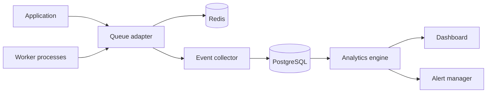

# QueueLens

> A self-hosted observability platform for distributed background job systems.


[](LICENSE)


**Status: skeleton (v0.0.0).** This repository contains the project structure, architecture decisions and
an implementation plan. **Nothing is functional yet.** The word "works" does not appear below unless it is
true.

## Why this exists

Background jobs fail quietly. A queue drains, retries pile up, a worker goes stale, and the first
signal is a customer complaint. Existing APM tools treat jobs as traces, not as work. QueueLens models the
job lifecycle directly: enqueued, started, retried, failed, stalled, completed.

## What it will do

| Capability | Milestone | Status |
|---|---|---|
| Live queue monitoring | M3 | Not started |
| Job execution timelines | M4 | Not started |
| Failed and stalled job detection | M3 | Not started |
| Worker health tracking | M2 | Not started |
| Processing latency statistics | M4 | Not started |
| Retry and failure analysis | M5 | Not started |
| Configurable alerting | M5 | Not started |
| Historical performance analytics | M6 | Not started |
| Additional queue adapters | M6 | Not started |

## Architecture



Full reasoning, data model, API surface and failure behaviour are in [docs/PLAN.md](docs/PLAN.md).

## Engineering challenge

Tracking distributed job execution accurately without adding meaningful overhead to the
application being monitored. Instrumentation that blocks a job is worse than no instrumentation.

## Quickstart

Not runnable yet. The skeleton builds and prints its version:

```bash
make build
./bin/queuelens version
```

Full local stack (Postgres, Redis, API, workers) arrives with
milestone M1.

## Repository layout

| Path | Purpose |
|---|---|
| `cmd/queuelens` | Server entry point (collector API, web API) |
| `internal/adapter` | Adapter interface and registry |
| `internal/collector` | Ingest pipeline, buffering, backpressure |
| `internal/store` | PostgreSQL persistence and partitioning |
| `internal/analytics` | Aggregations, latency percentiles, stall detection |
| `internal/api` | HTTP API for the dashboard |
| `internal/alert` | Alert rules and notification delivery |
| `pkg/protocol` | Versioned event schema and adapter contract |
| `web` | React dashboard (M4) |
| `tests/load` | Load generator and overhead benchmarks |

## Roadmap

| Milestone | Deliverable | Status |
|---|---|---|
| M1 | Adapter interface, Redis adapter and event collection | Not started |
| M2 | Worker instrumentation and worker health tracking | Not started |
| M3 | Job lifecycle tracking, failed and stalled detection | Not started |
| M4 | Dashboard with queue state and job timelines | Not started |
| M5 | Metrics, alerting and retry analysis | Not started |
| M6 | Historical analytics, horizontal scaling, extra adapters | Not started |

This roadmap mirrors [docs/PLAN.md](docs/PLAN.md) section 12. If the two disagree, the plan is correct and
the README is a bug.

## Project standards

- Conventional Commits, Semantic Versioning, `main` is always green.
- Every release is produced by CI, never by a laptop.
- Status claims must match reality. Unbuilt features are marked "Not started", not "coming soon".
- Decisions are recorded as ADRs in [docs/adr/](docs/adr/).

## Contributing

Read [CONTRIBUTING.md](CONTRIBUTING.md) and [docs/PLAN.md](docs/PLAN.md) first. Issues labelled
`good first issue` are scoped for a first pull request.

## Using an AI assistant on this repository

Read [docs/PLAN.md](docs/PLAN.md) end to end, including the machine context block at the top. It states
what exists, what does not, and which claims are forbidden. Do not describe planned behaviour as
implemented behaviour.

## License

Apache License 2.0 - see [LICENSE](LICENSE).
