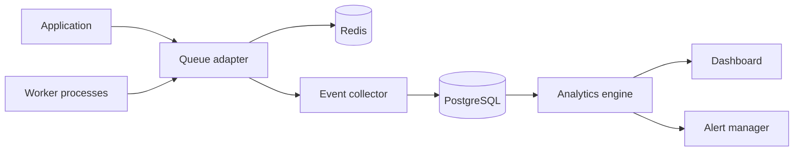
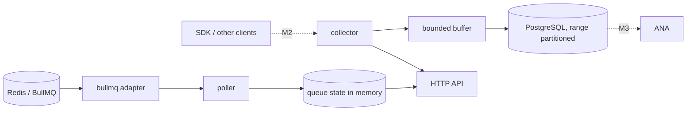

# QueueLens Architecture

**Status: partially implemented (M1).** The collector, the BullMQ adapter, the raw event storage and
the load generator exist and are tested against a real PostgreSQL and a real Redis. The analytics
engine, the dashboard, the alert manager and the SDK do not exist yet. The authoritative
specification is [PLAN.md](PLAN.md), and section 0 there is the current truth.

## Context

A self-hosted observability platform for distributed background job systems.

Background jobs fail quietly. A queue drains, retries pile up, a worker goes stale, and the first
signal is a customer complaint. Existing APM tools treat jobs as traces, not as work. QueueLens models the
job lifecycle directly: enqueued, started, retried, failed, stalled, completed.

## Shape

## What exists today

| Package | Responsibility |
|---|---|
| `pkg/protocol` | The wire contract: event schema, validation, redaction, sortable identifiers. No dependency on the rest of the code, because adapters in other languages implement the same contract. |
| `internal/adapter` | The interface every queue adapter implements. An adapter reports counts; it never blocks the collector and never applies business logic. |
| `internal/adapter/bullmq` | Reads BullMQ's Redis keys directly, with `SCAN` rather than `KEYS`. The key layout was verified against BullMQ 6.7.6 by an integration test that seeds a real queue with the real library. |
| `internal/poller` | Drives the adapters on a fixed interval. A failing adapter is isolated: the error is counted, the last known state is kept and marked stale, the poller keeps running. |
| `internal/queues` | The last known state of every queue, in memory. It is a live view of the broker, not history. |
| `internal/collector` | Validate, redact, buffer, batch. No business logic, no unbounded buffering: a full buffer drops the newest events, counts them and answers 429. |
| `internal/store` | Writes batches to PostgreSQL with `COPY` into a range-partitioned table. |
| `internal/api` | The HTTP endpoints: ingest, queue list, health, readiness, metrics. |
| `internal/loadgen` | The load generator, so that throughput claims come from a measurement. |
| `internal/metrics` | The collector's counters, in the Prometheus text format. Plain atomics, no client library: instrumentation must not eat the overhead budget. |

## Data path

Two ingestion paths exist and they are not equivalent:

1. **Push (SDK)** — the application emits lifecycle events. Precise, requires an integration. Arrives
   with M2.
2. **Pull (adapter)** — QueueLens polls the broker. Works with no code change, cannot see in-job
   timing.

M1 ships the pull path and the ingest endpoint. The SDK arrives in M2 and is what makes latency
accurate.

## Failure behaviour

| Failure | What happens |
|---|---|
| Redis is unreachable | The adapter poll fails, the error is counted, the last known queue state stays available and is marked `stale`. The collector keeps serving. |
| PostgreSQL is unreachable | The readiness check fails, batch writes are counted as errors, the events in the failed batch are lost. There is no disk queue in M1; that is M3 work. |
| The buffer is full | The newest events are dropped, `queuelens_buffer_dropped_total` goes up, and the request that hit the limit gets 429 with `Retry-After: 1`. |
| A partition for the current month is missing | The collector creates it at startup. Creating partitions further ahead is M3 work. |
| A malformed event | It is rejected on its own with a reason. The rest of the batch is still accepted. |

## Component responsibilities

See [PLAN.md](PLAN.md) section 6 for the responsibility of each box, the request and event flows, and the
failure behaviour of each stage.

## What is deliberately absent

See [PLAN.md](PLAN.md) section 4 (non-goals). If a component is not on that diagram, it is not part of the
design.
