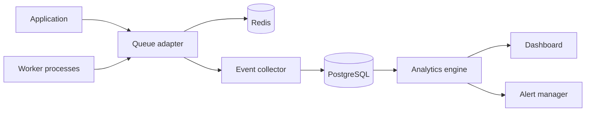
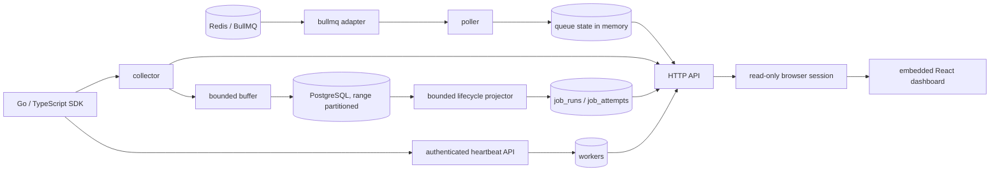

# QueueLens Architecture

**Status: M4 locally implemented/verified on `feat/m4-implementation`; publication/CI pending.**
M1–M3 remain complete and merged into main, with local and post-merge CI verification.
[PR #2](https://github.com/Shellghostt/QueueLens/pull/2) merged at `12b5940` with the exact tested M3 tree.
The collector, BullMQ adapter, both SDKs, producer-identity ledger, bounded job projections,
failure/stall/worker queries and checked retention exist. M2 SDK/protocol wire semantics are preserved;
Go SDK recovery follows ADR 0005.
The bounded dashboard, timelines, selected-outcome cache and separate browser sessions now exist.
Rollup analytics and alerts remain M5. The authoritative specification is
[PLAN.md](PLAN.md), [M3 requirements](phases/M3.md) and accepted ADRs; verification is in
[M3 validation](testing/m3-lifecycle.md).
M4 evidence is in [validation](testing/m4-dashboard.md) and [measurements](benchmarks/m4-dashboard.md).

## Context

A self-hosted observability platform for distributed background job systems.

Background jobs fail quietly. A queue drains, retries pile up, a worker goes stale, and the first
signal is a customer complaint. Existing APM tools treat jobs as traces, not as work. QueueLens models the
job lifecycle directly: enqueued, started, retried, failed, stalled, completed.

## Planned product shape

## What exists today

| Package | Responsibility |
|---|---|
| `pkg/protocol` | The wire contract: event schema, validation, redaction, sortable identifiers. No dependency on the rest of the code, because adapters in other languages implement the same contract. |
| `internal/adapter` | The interface every queue adapter implements. An adapter reports counts; it never blocks the collector and never applies business logic. |
| `internal/adapter/bullmq` | Reads BullMQ's Redis keys directly, with `SCAN` rather than `KEYS`. The key layout was verified against BullMQ 6.7.6 by an integration test that seeds a real queue with the real library. |
| `internal/poller` | Drives the adapters on a fixed interval. A failing adapter is isolated: the error is counted, the last known state is kept and marked stale, the poller keeps running. |
| `internal/queues` | The last known state of every queue, in memory. It is a live view of the broker, not history. |
| `internal/collector` | Validate, redact, buffer, batch. No business logic, no unbounded buffering: a full buffer drops the newest events, counts them and answers 429. |
| `internal/store` | Atomic identity verification and durable COPY; bounded projector, paginated queries, checked partition maintenance and retention. |
| `internal/lifecycle` | Pure deterministic attempt summaries, evidence response types and receipt-based suspicion policy. |
| `internal/dashboard` | M4 bounds, exact query/filter contracts and combined evidence response types. |
| `web` | React/TypeScript polling client, accessible views and optional Go embedded assets. |
| `sdk/go`, `sdk/typescript` | Bounded asynchronous metadata transport, batching, heartbeats and worker drop counters. |
| `internal/api` | Authenticated ingest, heartbeat, queue list and four paginated lifecycle/worker routes; operational endpoints. |
| `internal/loadgen` | The load generator, so that throughput claims come from a measurement. |
| `internal/metrics` | The collector's counters, in the Prometheus text format. Plain atomics, no client library: instrumentation must not eat the overhead budget. |

## Data path

Two ingestion paths exist and they are not equivalent:

1. **Push (SDK)** — the application emits lifecycle events and duration metadata. Requires integration.
2. **Pull (adapter)** — QueueLens polls the broker. Works with no code change, cannot see in-job
   timing.

The SDK copies metadata on Emit and performs network work in a background goroutine or scheduled
task. Default capacity is 10,000, batch size 500, flush interval 250 ms and HTTP deadline two seconds.
Slow requests may delay flushes; Emit stays independent. Heartbeats default to 15 seconds and persist
server receipt time. Worker suspicion is evaluated on UTC query ticks after 60 seconds without
a receipt, default five-second cadence. This does not prove worker/job death. See ADR 0004 for
the unchanged wire/delivery contract and ADR 0006 for evidence policy.

## Lifecycle transactions and retention

New provided event IDs are scoped to their queue and persisted with a fixed digest key and normalized
content fingerprint. Under schema-scoped retention/claims locks, one bounded array query verifies
identities, then new ledger and raw rows COPY and commit together. Identical retained IDs are no-ops;
conflicts reject the batch. Missing/legacy IDs remain unknown. Source timestamp text preserves
nanoseconds despite PostgreSQL's microsecond timestamp precision.

The projector visits one checked partition and at most 1,000 pending `(ts,id)` rows per transaction.
Attempt/run updates and exact row processing markers commit together. Its persisted round-robin
cursor revisits partitions, including lower sequence IDs committed late. The highest observed attempt
wins, with same-attempt precedence `completed > retried > failed > stalled > started > enqueued`;
timestamp/fingerprint settle ties. Summaries retain distinct observed attempts and contradictory,
missing, legacy and possible-reuse evidence. Missing duration stays unknown.

Queries use C-order keyset pagination (100 default, 200 maximum) and signed cursors bound to route,
filter and evaluation time. Lag is a bounded committed-row sample; timeout is unknown. This is a live
view, not a cross-request snapshot or proof of complete history.

Maintenance creates current/next two UTC months and the needed late-arrival month. It visits at most
eight partitions and bounds each cleanup category to 1,000 rows. A partition drop requires checked
name/parent/calendar bounds, expired bounds and receipts, no pending facts, finite locks and no
`CASCADE`. Raw/history defaults are 30 days. Durable pruning phases handle runs with more than
1,000 attempts; pruning runs are temporarily omitted from pages, pending fresh facts wait for cleanup,
and reconstruction carries a retained tombstone flag.
Unresolved/incomplete runs have an absolute age cap, so long jobs can lose projected history.
The complete policies and refinements are in ADRs 0006–0010.

## Failure behaviour

| Failure | What happens |
|---|---|
| Redis is unreachable | The adapter poll fails, the error is counted, the last known queue state stays available and is marked `stale`. The collector keeps serving. |
| PostgreSQL is unreachable | Readiness fails, batch writes are counted as errors and failed-batch events are lost. Transport is best effort; a disk queue is not in M3 scope. |
| The buffer is full | The newest events are dropped, `queuelens_buffer_dropped_total` goes up, and the request that hit the limit gets 429 with `Retry-After: 1`. |
| Collector unreachable from SDK | Transport drops are counted in worker `queuelens_dropped_total`; jobs continue and failed events are not retried. Go discards queued/new events until an authenticated recovery heartbeat succeeds; flush ticks probe without reopening event encoding. |
| SDK buffer full | Newest events are dropped and counted immediately. |
| Worker shutdown | Stop producers, then Close with a deadline. Undelivered events are counted; collector acceptance is not database durability. |
| A required partition is missing | Startup/maintenance idempotently create current/next two months and the seven-day late-arrival month. Unrecognized names/bounds are refused. |
| A malformed event | It is rejected on its own with a reason. The rest of the batch is still accepted. |
| A retained producer ID has conflicting content | The asynchronous storage transaction rolls back ledger/raw writes; accepted-batch losses/errors are counted. |
| Projection is behind or a query deadline expires | Pages expose committed lag, or unknown lag; missing facts do not become fabricated job outcomes. |

## Component responsibilities

See [PLAN.md](PLAN.md) section 6 for the responsibility of each box, the request and event flows, and the
failure behaviour of each stage.

## What is deliberately absent

See [PLAN.md](PLAN.md) section 4 (non-goals). If a component is not on that diagram, it is not part of the
design.

## M3 evidence

All local M3 gates are mapped in [validation](testing/m3-lifecycle.md); measured throughput,
SDK overhead, storage latency and sampling limits are in [measurements](benchmarks/m3-lifecycle.md).
Native Windows race passes with x64 GCC; CI also passed race/build tests on Windows, Ubuntu and macOS.
Publication/run links are in validation and the
[post-merge CI run](https://github.com/Shellghostt/QueueLens/actions/runs/43823539904).
No new tagged release is claimed.

## M4 reads and browser access

Accepted [ADR 0011](adr/0011-m4-query-and-dashboard-contract.md) adds five authenticated
`/v1/dashboard/*` routes. Overview and queue detail combine bounded broker/job pages with selected
outcome metrics; job detail combines a retained run and a separately paginated attempt page.
Exact UTF-8 identities are query parameters. Signed cursors bind route/filter/window/job/time,
lists cap at 200, raw queries at 12 KiB and buffered responses at 2 MiB. Run and attempts share
a read-only REPEATABLE READ snapshot so concurrent pruning cannot expose half-deleted histories.

Migration 0004 backfills indexed selected state/time/conflict caches and the projector updates
them atomically with unchanged M3 summaries. Selected supplied timestamps are floored to
microseconds before database parsing to preserve whole-second window membership; original
JSON precision remains. Metrics use UTC 1h/24h/7d/30d windows, exclude pruning runs and cap work
at 500,000 terminal attempts plus a sentinel and 150 ms. Missing cache, history coverage,
overflow or timeout is unavailable/null. Throughput/failure fractions describe retained selected
attempts, never broker set deltas or complete production-job history. The existing lag sampler
stays a separate bounded raw-receipt query.

Opt-in browser access uses a separate password, exact origin/host, opaque in-memory four-hour
sessions and HttpOnly/Secure/SameSite Strict production cookies. A fixed read-only six-route
dispatch exposes the same handlers plus M3 worker reads. Bearer ingestion/admin credentials
stay on the server. Explicit HTTP loopback development uses a distinct cookie.

The React client requests one view at a time, keeps one bounded page, polls every five seconds,
aborts route/filter/unmount changes, pauses hidden tabs and backs off failed reads while retaining
visible stale data. Unauthorized/logout/expiry clears the view; timers/listeners are released.
Metadata renders as text. Make/container production builds embed locked Vite assets behind a
Go build tag; ordinary headless Go builds remain compatible. Hourly rollups/alerts remain M5.
