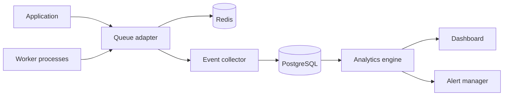

# QueueLens Architecture

**Status: planned. No implementation exists yet.** This document describes intended structure, not
delivered behaviour. The authoritative specification is [PLAN.md](PLAN.md).

## Context

A self-hosted observability platform for distributed background job systems.

Background jobs fail quietly. A queue drains, retries pile up, a worker goes stale, and the first
signal is a customer complaint. Existing APM tools treat jobs as traces, not as work. QueueLens models the
job lifecycle directly: enqueued, started, retried, failed, stalled, completed.

## Intended shape

## Component responsibilities

See [PLAN.md](PLAN.md) section 6 for the responsibility of each box, the request and event flows, and the
failure behaviour of each stage.

## What is deliberately absent

See [PLAN.md](PLAN.md) section 4 (non-goals). If a component is not on that diagram, it is not part of the
design.
