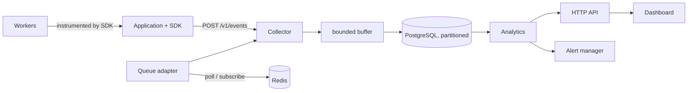

# QueueLens — Implementation Plan

> **This file is the specification.** The overhead budget in section 9 is a release gate, not an aspiration.

---

## 0. Machine context

M1–M3 are merged into `main`. M3 is **complete**, runtime/test source `728999d`,
merged through [PR #2](https://github.com/Shellghostt/QueueLens/pull/2) at `12b5940`.
The merged tree matched tested head `c931b9b`; all eight
[post-merge CI jobs](https://github.com/Shellghostt/QueueLens/actions/runs/43823539904) passed,
including Windows/Ubuntu/macOS race.
The [M3 requirements](phases/M3.md) are the acceptance contract, with decisions in ADRs 0006–0010.
[Validation](testing/m3-lifecycle.md) and [measurements](benchmarks/m3-lifecycle.md) record actual gates,
diagnosed failures and limits. The [development-tool audit](DEVELOPMENT-TOOLS.md) describes optional aids.
The M3 documentation is also merged through [PR #4](https://github.com/Shellghostt/QueueLens/pull/4);
current main is `209707149e25701d8b4f8c896d6402226498cd3d`, with successful
[main CI](https://github.com/Shellghostt/QueueLens/actions/runs/43827229518).
M4 is **implemented and locally verified on `feat/m4-implementation`; publication/CI pending**.
[M4 requirements](phases/M4.md), accepted [ADR 0011](adr/0011-m4-query-and-dashboard-contract.md),
[validation](testing/m4-dashboard.md) and [measurements](benchmarks/m4-dashboard.md) map the bounded
queries, selected-outcome read model, browser sessions, polling UI and actual gates.

```yaml
project: QueueLens
status: mvp
version: 0.1.0
builds: true
functional: partial            # M1–M4 work locally; M4 CI and M5 analytics/alerts remain

implemented:
  - repository skeleton
  - protocol v1 in pkg/protocol: event schema, validation, redaction, sortable ids
  - adapter interface (internal/adapter)
  - bullmq adapter reading redis directly, verified against bullmq 6.7.6
  - collector ingest api: POST /v1/events with per-event rejection reasons
  - bounded buffer with a 429 saturation path and a drop counter
  - postgres storage: range-partitioned queue_events table, migrations, COPY writer
  - query api: GET /v1/queues
  - operational endpoints: /healthz, /readyz, /metrics
  - load generator (queuelens loadgen) and a committed benchmark report
  - unit tests and integration tests against a real postgres and a real redis
  - go and typescript worker sdk with bounded async buffers and drop counters
  - authenticated worker heartbeat api and workers table
  - shared protocol conformance and million-job overhead benchmarks
  - Go SDK recovery probes keep failed collectors from repeatedly reopening event encoding
  - persistent producer identity with atomic duplicate/conflict handling and M2 migration compatibility
  - bounded deterministic job_runs/job_attempts projections with exact transactional processing markers
  - authenticated paginated failure/stall/worker evidence, signed cursors and bounded lag queries
  - explicit stall and configurable receipt-based job/worker suspicion without retry-exhaustion inference
  - checked UTC monthly partition maintenance and raw/history retention with durable bounded pruning
  - bounded queue/job/attempt reads and indexed selected-outcome metric windows
  - separate read-only browser sessions and embedded cancellable polling React dashboard

not_implemented:
  - metrics_hourly, alert_rules, alerts_fired tables
  - analytics and rollups
  - alerting
  - additional adapters (sqs, celery, sidekiq)
  - full prometheus exporter

source_of_truth:
  scope_and_schema: docs/PLAN.md        # this file, section 9 for the event schema
  architecture: docs/ARCHITECTURE.md
  decisions: docs/adr/
  protocol: pkg/protocol/
  api: api/openapi.yaml
  benchmark: docs/benchmarks/
  status: README.md#roadmap

forbidden_claims:
  - "supports <queue system>" that is not in the adapter table
  - any overhead percentage not produced by tests/bench
  - "real-time" (state the actual p99 ingest latency instead)
  - "no performance impact"

if_uncertain:
  - an adapter is only supported when it has an integration test against a real broker
  - if a number was not measured in this repository, it does not go in the README
```

---

## 1. What this is

A self-hosted observability platform for background job systems. It models the job lifecycle — enqueued,
started, retried, failed, stalled, completed — instead of treating a job as a trace span.

One-line description: *A self-hosted observability platform for distributed background job systems.*

---

## 2. Problem and users

**Problem.** Background jobs fail quietly. A queue grows, retries pile up, a worker stops heartbeating, and
the first signal is a customer complaint. Generic APM shows you a slow span, not "this queue has 40,000
waiting jobs and 12% of them failed in the last hour".

**Users.**

| User | Need |
|---|---|
| Backend engineer | See why one job failed and how many times it retried |
| On-call engineer | Know before the customer does: queue depth, stalls, worker death |
| Platform team | Throughput and latency history per queue, without a vendor |

**Success looks like.** A stalled worker is visible on the dashboard within 60 s, and the on-call engineer
can open the affected job and see its full attempt timeline.

---

## 3. Non-goals

- **Not a queue.** It observes; it never enqueues or consumes production jobs.
- **Not a job scheduler.** Delayed retries stay the queue's responsibility.
- **Not a general APM.** No HTTP tracing, no database query analysis.
- **Not multi-tenant SaaS.** One deployment, one organisation. Auth is a single admin token in v1.
- **No arbitrary user-defined query language** in v1. Alert rules are a fixed set.
- **No log aggregation.** Errors are captured as job metadata, not as a log store.

---

## 4. Scope contract

### v0.1 — MVP (M1–M4)

BullMQ adapter, collector ingest API, Postgres storage, job lifecycle and stall detection, dashboard with
queue overview and job timeline.

### v1.0 (M5–M6)

Latency analytics, alerting, horizontal scaling, Asynq adapter, v1.0.0. Retention/partitioning are
already implemented in M3; later milestones build on those contracts.

### Post-1.0

Sidekiq, Celery, custom adapter SDK published as a Go module, Prometheus exporter endpoint.

---

## 5. Locked decisions

| # | Decision | Rationale |
|---|---|---|
| 1 | Go backend | Stream ingestion is a throughput problem; predictable memory matters |
| 2 | React + TypeScript dashboard | Best ecosystem for data-dense UI |
| 3 | Adapter interface first, one adapter properly | An abstraction invented before two implementations is always wrong |
| 4 | BullMQ is the first adapter | Largest install base among Redis-backed Node queues |
| 5 | Instrumentation never blocks a job | Bounded buffer, drop with a counter, never backpressure the worker |
| 6 | Versioned wire protocol `v1` | Non-Go adapters implement it without importing Go packages |
| 7 | PostgreSQL before ClickHouse | At realistic volumes, partitioned Postgres is sufficient |
| 8 | Overhead < 2% p50 is a release gate | Measured in `tests/bench`, not asserted in prose |

**Rejected alternatives:** polling Redis `KEYS` (does not scale, no history), an agent inside the application
that owns its own storage (operationally heavy), Kafka ingestion (adds a dependency before the product has
users), stored procedures for analytics (hard to test, hard to evolve).

---

## 6. Architecture



### Components

| Component | Responsibility | Must never |
|---|---|---|
| Adapter | Translate broker state into protocol events | Block on the collector |
| Collector | Validate, buffer, batch-insert events | Apply business logic |
| Storage | Partitioned event table, rollups | Store unbounded raw events |
| Analytics | Lifecycle reconstruction, percentiles, stall detection | Query raw events for every dashboard request |
| API | Serve dashboard queries | Expose unbounded result sets |
| Alert manager | Evaluate rules, deduplicate, notify | Fire on a single sample |
| SDK | Emit events with negligible overhead | Require network calls from the job path |

### Data path

Two ingestion paths exist and they are not equivalent:

1. **Push (SDK)** — the application emits lifecycle events. Precise, requires an integration.
2. **Pull (adapter)** — QueueLens polls the broker. Works with no code change, cannot see in-job timing.

M1 shipped the pull path and ingest endpoint. M2 adds SDK push instrumentation with explicit duration
metadata. SDK source is merged into `main`; this is not a claim of an npm/Go package release.

---

## 7. Data model

The M3 identity/projection schema and CHECK/index definitions are authoritative in
[migration 0003](../migrations/0003_lifecycle.sql). The abbreviated model below includes M3 raw/run
columns; metrics and alert tables remain planned M5 schemas.

```sql
CREATE TABLE queue_events (
    id           bigserial,
    ts           timestamptz NOT NULL,
    queue        text NOT NULL,
    job_id       text NOT NULL,
    job_name     text NOT NULL DEFAULT '',
    attempt      smallint NOT NULL DEFAULT 1,
    state        text NOT NULL CHECK (state IN
                 ('enqueued','started','completed','failed','retried','stalled','drained')),
    worker_id    text,
    duration_ms  integer,
    error        text,
    received_at  timestamptz NOT NULL DEFAULT now(),
    event_id     text,
    event_key    bytea,
    content_fingerprint bytea,
    source_ts    text,
    identity_kind text NOT NULL DEFAULT 'legacy',
    projected_at timestamptz,
    projection_status text,
    PRIMARY KEY (ts, id)
) PARTITION BY RANGE (ts);

CREATE TABLE job_runs (
    queue        text NOT NULL,
    job_id       text NOT NULL,
    reported_attempt smallint NOT NULL,
    observed_attempts integer NOT NULL,
    incomplete_attempts integer NOT NULL,
    state        text NOT NULL,
    first_received_at timestamptz NOT NULL,
    last_received_at timestamptz NOT NULL,
    complete_observed boolean NOT NULL,
    pruning_at   timestamptz,
    summary      jsonb NOT NULL,
    PRIMARY KEY (queue, job_id)
);

CREATE TABLE event_identities (
    queue        text NOT NULL,
    event_key    bytea NOT NULL,
    event_id     text NOT NULL,
    content_fingerprint bytea NOT NULL,
    first_received_at timestamptz NOT NULL DEFAULT clock_timestamp(),
    PRIMARY KEY (queue, event_key)
);

CREATE TABLE workers (
    worker_id   text PRIMARY KEY,
    pool        text NOT NULL DEFAULT '',
    first_seen  timestamptz NOT NULL DEFAULT now(),
    last_seen   timestamptz NOT NULL DEFAULT now()
);

-- Planned M5, not implemented:
CREATE TABLE metrics_hourly (
    queue        text NOT NULL,
    bucket       timestamptz NOT NULL,
    enqueued     integer NOT NULL DEFAULT 0,
    completed    integer NOT NULL DEFAULT 0,
    failed       integer NOT NULL DEFAULT 0,
    p50_ms       integer,
    p95_ms       integer,
    p99_ms       integer,
    PRIMARY KEY (queue, bucket)
);

CREATE TABLE alert_rules (
    id          uuid PRIMARY KEY DEFAULT gen_random_uuid(),
    name        text NOT NULL,
    kind        text NOT NULL CHECK (kind IN
                ('queue_depth','failure_rate','p99_latency','stalled_jobs','worker_down')),
    threshold   numeric NOT NULL,
    window_s    integer NOT NULL DEFAULT 300,
    enabled     boolean NOT NULL DEFAULT true
);

CREATE TABLE alerts_fired (
    id          bigserial PRIMARY KEY,
    rule_id     uuid NOT NULL REFERENCES alert_rules(id) ON DELETE CASCADE,
    fired_at    timestamptz NOT NULL DEFAULT now(),
    resolved_at timestamptz,
    value       numeric NOT NULL,
    payload     jsonb NOT NULL DEFAULT '{}'
);
```

M3 also creates `job_attempts` (one compact summary per retained attempt), `projection_state`
(durable partition scan positions) and `pruned_jobs` (bounded-lifetime reconstruction tombstones).
Current/next two UTC months and the seven-day late-arrival month are created idempotently.
Raw/history defaults are 30 days. A partition drop requires fully expired event-time bounds and
receipts, no pending rows and checked metadata under finite locks; coarse retention can add nearly
another month and backlog can extend it. Rollups/400-day retention remain M5.

M3 stores provided protocol IDs with queue-scoped digest keys in a separate identity ledger.
Identical retained IDs are no-ops; conflicting normalized content rolls back the storage batch.
Missing/legacy IDs remain unknown. The raw bigserial is processing identity, not an SDK ID.
Ledger cleanup retains entries while raw references exist. See ADRs 0006–0010 for complete policies.

---

## 8. API surface

Collector:

| Method | Path | Purpose |
|---|---|---|
| POST | `/v1/events` | Batch ingest, max 1,000 events or 1 MiB |
| POST | `/v1/workers/heartbeat` | Worker liveness |

Query API:

| Method | Path | Purpose |
|---|---|---|
| GET | `/v1/queues` | Existing unpaginated live broker counts/depth; no historical rates |
| GET | `/v1/dashboard/overview` | Bounded broker page plus selected-outcome metrics |
| GET | `/v1/dashboard/queues` | Bounded broker queue page |
| GET | `/v1/dashboard/queue` | Exact `queue` parameter; optional broker, metrics and job page |
| GET | `/v1/dashboard/jobs` | Exact optional queue and observed-state filters |
| GET | `/v1/dashboard/job` | Exact queue/job parameters and separately paginated attempts |
| GET | `/v1/workers` | Worker list with last heartbeat |
| GET | `/v1/jobs/failed` | M3 paginated observed-failure evidence |
| GET | `/v1/jobs/stalled` | M3 paginated explicit-stall evidence |
| GET | `/v1/jobs/suspected-stalled` | M3 paginated no-job-receipt suspicion |
| GET | `/v1/metrics/timeseries` | `?queue=&metric=&from=&to=&step=` |
| GET/POST/PATCH | `/v1/alert-rules` | Alert rule CRUD |
| GET | `/v1/alerts` | Fired alerts |
| GET | `/healthz`, `/readyz`, `/metrics` | Operational |

Auth: `Authorization: Bearer <token>` from `QUEUELENS_ADMIN_TOKEN` (legacy `QUELENS_*` aliases remain). The collector accepts the same token; v1 has
no separate ingest key.

Ingest response: `202 {"accepted": 1000, "dropped": 0}`. On saturation: `429` with `Retry-After: 1`.
The SDK treats both as non-fatal and never retries synchronously.

Implemented in M1: `POST /v1/events`, `GET /v1/queues`, `GET /healthz`, `GET /readyz` and
`GET /metrics`. M2 also implements `POST /v1/workers/heartbeat` for receipt-time persistence.
M3 implements `/v1/jobs/failed`, `/v1/jobs/stalled`, `/v1/jobs/suspected-stalled` and `/v1/workers`.
They default to 100 items, cap at 200 and expose opaque signed cursors, evaluation time, lag and
history limitations. M4 adds the five `/v1/dashboard/*` routes above; legacy `/v1/queues` is unchanged.
The six same-origin `/dashboard/api/{overview,queues,queue,jobs,job,workers}` read routes use a separate
browser session. `POST/GET/DELETE /dashboard/session` provide login/bootstrap/logout. Parameters,
resource bounds, read-only session policy and rate meaning follow accepted ADR 0011. Broker retained
set sizes are not monotonic counters. Timeseries and alert paths remain planned M5; OpenAPI lists
only implemented API paths.

One addition to the response shape: `rejected` holds one entry per rejected event
(`{"index": 1, "id": "...", "reason": "job_id: is required"}`), so a producer can tell which event to
fix. The counts `accepted` and `dropped` are unchanged.

---

## 9. Core contract: protocol and overhead

### Event schema v1

```json
{
  "v": 1,
  "id": "01J8Z8Q9K3",
  "ts": "2026-11-13T10:00:00.123Z",
  "queue": "email",
  "job_id": "8891",
  "job_name": "send-welcome",
  "attempt": 2,
  "state": "failed",
  "worker_id": "w-7",
  "duration_ms": 340,
  "error": "SMTP timeout"
}
```

Unknown fields are ignored; `v` must be `1`. Missing `queue` or `job_id` rejects the event. `ts` older than
7 days is rejected (clock skew guard) but counted, not silently dropped.

### Overhead budget (release gate)

| Metric | Budget |
|---|---|
| Added p50 latency per instrumented job | < 2% |
| Added p99 latency | < 5% |
| Allocation per emitted event | < 512 B |
| Collector ingest | < 50 ms per 1,000-event batch |
| Drop rate under load test with a dead collector | 100% of events, 0% of jobs blocked |

The Go SDK's `Emit` is a non-blocking send to a buffered channel; TypeScript uses a fixed ring
(default capacity 10,000). On a full buffer it increments
`queuelens_dropped_total` and returns. **It never blocks and never allocates on the hot path beyond the event
struct.**

M2 measurements and their workload limits are recorded in
[benchmarks/m2-sdk-overhead.md](benchmarks/m2-sdk-overhead.md). Go Emit has zero measured allocations;
TypeScript's successful enqueue allocation is sampled using Node's heap profiler. The collector row was
measured in M1: a 1,000-event batch takes 3.18 ms at p50 and 5.41 ms at p99 end to end over HTTP on
loopback, and the storage write of 1,000 rows takes 7.51 ms against a local PostgreSQL 16 server. The
budget is 50 ms. The measurements, the hardware and the method are in
[benchmarks/m1-ingest-5000eps.md](benchmarks/m1-ingest-5000eps.md).

### Lifecycle reconstruction

M3 folds retained `(queue,job_id,attempt)` summaries. The highest observed attempt wins;
same-attempt precedence is `completed > retried > failed > stalled > started > enqueued`, then
event timestamp/fingerprint. Duplicate starts do not increment distinct observed-attempt counts.
Missing events leave unknown timings/history; `drained` is queue evidence and creates no job.
Each bounded partition transaction commits summaries with exact `(ts,id)` processing markers.
The persisted round-robin scan revisits lower IDs committed late. Job-ID reuse and contradictory
source facts remain evidence flags, without an invented generation or retry-exhaustion claim.
See [M3 requirements](phases/M3.md), ADR 0006 and the named validation tests.

### Stall detection

| Condition | Verdict |
|---|---|
| Explicit `stalled` event | Observed stall evidence |
| No progress beyond an explicitly configured threshold | Suspected stall; missing telemetry remains possible |
| No worker receipt-time heartbeat for 60 s | Suspected worker down, visible on the next evaluation tick |
| `failed` event without retry-exhaustion evidence | Observed failure, not proof of terminal/dead job |

The protocol has no job heartbeat, expected duration or `max_attempts`. Do not infer them from worker
liveness. Worker suspicion uses 60-second receipt absence plus the next UTC evaluation tick
(default five seconds), visible when queried. Job suspicion defaults to 15 minutes without a job
receipt; zero disables it. Explicit stalls are independent source evidence. Projection backlog may
delay observations and is exposed as lag; no background notification or universal two-poll promise is made.

---

## 10. Configuration

| Variable | Default | Notes |
|---|---|---|
| `QUELENS_HTTP_ADDR` | `:8080` | API and collector |
| `QUELENS_POSTGRES_DSN` | required | |
| `QUELENS_REDIS_URL` | required for BullMQ adapter | |
| `QUELENS_ADMIN_TOKEN` | required | bearer token |
| `QUELENS_ADAPTERS` | `bullmq` | comma-separated |
| `QUELENS_POLL_INTERVAL` | `5s` | adapter poll cadence |
| `QUELENS_BUFFER_SIZE` | `10000` | collector buffer |
| `QUELENS_BATCH_SIZE` | `500` | insert batch |
| `QUELENS_RETENTION_RAW_DAYS` | `30` | checked whole-month raw retention |
| `QUELENS_RETENTION_HISTORY_DAYS` | `30` | projection/worker history and tombstones |
| `QUELENS_STALL_AFTER` | `15m` | no-job-receipt suspicion; `0s` disables |
| `QUELENS_EVALUATION_INTERVAL` | `5s` | UTC query ticks, 1 second–1 minute |
| `QUELENS_MAINTENANCE_INTERVAL` | `10m` | bounded cleanup/partition cadence |
| `QUELENS_PROJECTION_INTERVAL` | `250ms` | wait after empty cycle or error |
| `QUELENS_PROJECTION_BATCH_SIZE` | `1000` | one partition, maximum 1,000 pending rows |
| `QUELENS_RETENTION_ROLLUP_DAYS` | `400` | hourly rollups |
| `QUELENS_LOG_LEVEL` | `info` | |

M1 implementation notes: `QUEUELENS_*` is the canonical prefix and the `QUELENS_*` spelling above is
accepted as an alias, because a tool that ignores its own specification is a bug. The canonical name
wins when both are set. Two variables the plan does not list are implemented as well:
`QUEUELENS_BATCH_SIZE` is the events per database round trip (default 500, maximum 1,000) and
`QUEUELENS_FLUSH_INTERVAL` is the maximum time an event waits in the buffer (default 250 ms).

M3 implements raw/history retention and the lifecycle variables above, with canonical `QUEUELENS_*`
spellings and `QUELENS_*` aliases. Rollup retention is still unimplemented M5 work; no rollup tables exist.
Retention preserves unexpired receipts/pending raw rows and bounds projection cleanup; unresolved
runs have an absolute first-receipt age cap. Very long jobs can lose projected history.

---

## 11. Milestones

### M1 — Adapter interface and collection

**Deliverable:** adapter interface, BullMQ adapter (poll mode), collector ingest API, raw storage, load
generator.

**Acceptance criteria**

- [x] BullMQ queues, waiting/active/completed/failed counts visible via `GET /v1/queues`
- [x] Collector accepts 1,000-event batches and rejects malformed events with a per-event reason
- [x] Buffer saturation returns `429` and increments a counter; no event is silently lost without a counter
- [x] Load generator sustains 5,000 events/s ingest for 5 minutes on 4 vCPU
- [x] Adapter failure is isolated: a broken Redis connection does not crash the collector

Status note: the five-minute run was measured on 2026-11-13 with the collector pinned to four logical
processors of an AMD Ryzen 5 5600H: 1,500,000 events accepted at 4,999.99 events/s, p50 request
latency 1.17 ms, p99 2.50 ms, zero drops, zero rejected events, zero failed writes. The hardware, the
method and what the run does not prove are in
[benchmarks/m1-ingest-5000eps.md](benchmarks/m1-ingest-5000eps.md). The BullMQ counts are
checked against a real BullMQ 6.7.6 queue seeded by the committed fixture in
`tests/integration/bullmq`, not against a hand-written Redis fixture. The integration suite passes
locally against PostgreSQL 16.16 and Redis 7.2.17, and the CI workflow defines the same environment:
the first run on GitHub on 2026-11-13 passed against PostgreSQL 16 and Redis 7.2 with the real BullMQ
fixture.

M2 adds the SDK and the `workers` table (ADR 0004 supersedes that part of ADR 0002 decision 12).
The `job_runs`, `metrics_hourly`, `alert_rules` and `alerts_fired` tables arrive with M3 and M5. M1
creates the partition for the current month and the next one at startup; keeping two months ahead is
M3 work.

The race detector could not be run on the machine that produced this release: the only C compiler
there is MinGW GCC 6.3.0, which cannot build a 64-bit race-enabled binary
(`cc1.exe: sorry, unimplemented: 64-bit mode not compiled in`). The unit and integration suites
pass without the race detector, and CI runs `go test -race` on all three operating systems. The first
CI run on GitHub on 2026-11-13 executed it, and it passed on ubuntu-latest, windows-latest and
macos-latest.

### M2 — Instrumentation SDK

**Deliverable:** Go and TypeScript SDKs emitting lifecycle events, worker heartbeat, overhead benchmark.

**Acceptance criteria**

- [x] `Emit` never blocks under a dead collector (test: kill collector, run 1M jobs, assert job latency
      unchanged within noise)
- [x] Added p50 latency < 2% in `tests/bench`, report committed
- [x] Buffer overflow increments `queuelens_dropped_total`
- [x] SDK works with no configuration beyond the collector URL and token
- [x] Both SDKs implement protocol v1 and pass the shared conformance test

Evidence: [benchmark report](benchmarks/m2-sdk-overhead.md) and
[validation report](testing/m1-m2-validation.md). Heartbeats use server receipt time and persist
first/last seen plus optional pool. M3 adds receipt-based worker suspicion. SDKs are best effort;
stop producers before Close, and expose drop metrics from the worker process.

The Go SDK keeps a failed transport closed until an authenticated heartbeat probe returns HTTP 202.
Flush ticks probe while closed rather than admitting another burst of events to an unavailable collector;
failed events remain drops. [ADR 0005](adr/0005-go-sdk-recovery-probes.md) supersedes the Go cooldown
decision in ADR 0004. The benchmark workload and p50/p99 budgets remain unchanged.

### M3 — Lifecycle and failure analysis

**Deliverable:** durable event identity, `job_runs` folding, evidence-based stall/worker views and raw retention.

Status: **Complete and merged**, with local and post-merge CI verification;
[PR #2](https://github.com/Shellghostt/QueueLens/pull/2), merge `12b5940`.
Evidence is in [M3 validation](testing/m3-lifecycle.md) and
[measurements](benchmarks/m3-lifecycle.md). The current phase contract and ADR 0006 replace an
unconditional two-poll claim with bounded replay and explicit lag; backlog can delay source evidence.

**Acceptance criteria**

- [x] Out-of-order events fold into the correct final state (property test with shuffled input)
- [x] Explicit stall evidence is folded by bounded replay; suspected stalls are separate and lag is exposed
- [x] Worker-down suspicion appears after the 60 s threshold, within one evaluation interval when queried
- [x] Retention drops only fully expired partitions, preserving unexpired and unprocessed evidence
- [x] Partition creation covers the next two months automatically
- [x] Identity migration, duplicate/conflicting IDs and concurrent-commit checkpoint recovery pass
- [x] Paginated authenticated failure/stall/worker views expose lag and incomplete-history limitations

### M4 — Dashboard

**Deliverable:** React dashboard: overview, queue detail, job timeline, workers.

Status: **Implemented and locally verified; CI pending publication.** Accepted
[ADR 0011](adr/0011-m4-query-and-dashboard-contract.md) preceded code. The
[validation record](testing/m4-dashboard.md) maps every phase criterion to tests, browser checks,
measurements and the remaining CI gate. QL-019's existing M3 routes are preserved.

**Acceptance criteria**

- [x] Overview shows observed depth/selected-outcome rates with explicit UTC windows, denominators and stale/unknown states
- [x] Job timeline renders every retained attempt across pages, supplied duration/error and incomplete/pruned/reuse evidence
- [x] Dashboard p95 query < 300 ms over a declared 30-day retained-summary workload with concurrent projection/maintenance
- [x] No unbounded table: every list is paginated
- [x] Auth, safe rendering, cancellation/cache bounds and browser checks preserve M3 query/SDK/retention contracts locally
- [x] One screenshot in the README from a real local run
- [ ] Final Windows/Ubuntu/macOS and frontend CI pass after publication

### M5 — Metrics, alerts, analytics

**Deliverable:** hourly rollups with percentiles, alert rules, alert history, `/metrics` endpoint.

**Acceptance criteria**

- [ ] Percentiles computed from real durations, not averages of averages
- [ ] Alert fires once per window, not once per evaluation
- [ ] Alert resolves automatically when the condition clears
- [ ] Prometheus endpoint exposes queue depth, failure rate and collector lag
- [ ] Analytics queries use rollups, never scan raw partitions
- [ ] Dashboard p95 query < 300 ms for 30 days of hourly rollups after QL-023; record real workload/hardware

### M6 — Scale and second adapter

**Deliverable:** horizontal collector scaling, Asynq adapter, v1.0.0, capacity documentation.

**Acceptance criteria**

- [ ] Two collector instances behind a load balancer, no duplicate job state corruption
- [ ] Asynq adapter passes the same conformance suite as BullMQ
- [ ] Sustained 20,000 events/s ingest documented with hardware
- [ ] Overhead gate still passes after all additions
- [ ] `CHANGELOG.md` and README roadmap complete

---

## 12. Backlog

| ID | Task | Depends | Milestone | Status |
|---|---|---|---|---|
| QL-001 | Server skeleton, config, logging, health | — | M1 | Done |
| QL-002 | Protocol v1 types and validation | — | M1 | Done |
| QL-003 | Adapter interface and registry | QL-002 | M1 | Done (interface; no registry yet) |
| QL-004 | BullMQ adapter: queue discovery | QL-003 | M1 | Done |
| QL-005 | BullMQ adapter: counts by state | QL-004 | M1 | Done |
| QL-006 | Collector ingest endpoint with batching | QL-002 | M1 | Done |
| QL-007 | Bounded buffer and drop counter | QL-006 | M1 | Done |
| QL-008 | Batch writer to partitioned table | QL-007 | M1 | Done |
| QL-009 | Load generator | QL-006 | M1 | Done |
| QL-010 | Go SDK emit API | QL-002 | M2 | Done |
| QL-011 | TS SDK emit API | QL-002 | M2 | Done |
| QL-012 | Non-blocking buffer test (dead collector) | QL-010 | M2 | Done |
| QL-013 | Overhead benchmark and report | QL-012 | M2 | Done |
| QL-014 | Worker heartbeat endpoint and table | QL-001 | M2 | Done |
| QL-015A | Persist protocol event identity; define safe checkpoint and legacy-row semantics | QL-008 | M3 | Done (merged) |
| QL-015 | Lifecycle folder (events → job_runs) | QL-015A | M3 | Done (merged) |
| QL-016 | Out-of-order property test | QL-015 | M3 | Done (merged) |
| QL-017 | Observed/suspected stalls and worker-down suspicion | QL-015 | M3 | Done (merged) |
| QL-018 | Retention and partition maintenance | QL-008 | M3 | Done (merged) |
| QL-018A | Paginated failed/stalled/worker views and API contract | QL-017 | M3 | Done (merged) |
| QL-019 | Bounded queue/job/attempt queries and observed metric windows | QL-015, QL-018A | M4 | Locally verified; CI pending |
| QL-020 | Dashboard scaffolding | QL-019 | M4 | Locally verified; CI pending |
| QL-021 | Overview, queue detail and worker evidence views | QL-020 | M4 | Locally verified; CI pending |
| QL-022 | Paginated retained-attempt timeline and history limitations | QL-019, QL-021 | M4 | Locally verified; CI pending |
| QL-023 | Hourly rollups and percentiles | QL-015 | M5 | Not started |
| QL-024 | Alert rule evaluation and dedup | QL-023 | M5 | Not started |
| QL-025 | Alert notification channel | QL-024 | M5 | Not started |
| QL-026 | Prometheus `/metrics` | QL-023 | M5 | Partly done: the collector counters exist, the queue metrics do not |
| QL-027 | Multi-instance collector coordination | QL-008 | M6 | Not started |
| QL-028 | Asynq adapter + conformance suite | QL-003 | M6 | Not started |
| QL-029 | Capacity test and documentation | QL-027 | M6 | Not started |
| QL-030 | v1.0.0 release checklist | QL-025 | M6 | Not started |

---

## 13. Testing strategy

- **Conformance suite** runs against every adapter. A new adapter is not supported until it passes.
- **Property tests** for lifecycle folding with shuffled, duplicated and late events.
- **Overhead benchmark** is a CI job with a fixed workload; regression beyond budget fails the build.
- **Kill tests:** kill the collector, kill the collector mid-batch, kill Redis. The application must not
  notice beyond a dropped-event counter.
- **Query budget tests** assert dashboard history/metric queries read bounded summaries, not raw partition
  scans. Existing capped projection-lag sampling is separate and retains its own bounds/unknown behavior.

---

## 14. Security and threat model

| Threat | Mitigation |
|---|---|
| Collector used as an injection point | Strict schema validation, bounded batch, `queue`/`job_id` length limits |
| Error strings contain secrets | 1 KiB cap, redaction of common token patterns, documented as best-effort |
| Dashboard exposed publicly | Separate viewer password, exact HTTPS origin, bounded opaque HttpOnly/Secure/SameSite Strict sessions and read-only dispatch |
| SQL injection via queue names | Parameterized queries, exact bounded UTF-8 identities and allowlisted filters |
| Storage exhaustion | Retention, partitioning, ingest limit, 429 |
| Adapter credentials | Read from environment, never logged |

---

## 15. Risks and open questions

| Risk | Impact | Mitigation |
|---|---|---|
| Poll-only adapters miss in-job timing | Wrong latency numbers | SDK is the accurate path; UI labels poll-derived data |
| Overhead regression over time | Tool becomes a problem | Benchmark gate in CI |
| Postgres write amplification | Collector lag | Batch inserts, monthly partitions, rollups |
| Adapter abstraction leaks BullMQ concepts | Second adapter is a rewrite | Conformance suite forces protocol-level thinking |

**Open questions:**

1. Is a separate ingest token needed in v1? *Current: no, one admin token.*
2. Should `job_runs` be a materialised view or a table? *Current: table, updated by the folder.*
3. ClickHouse at what threshold? *Current: revisit at 50M events/day, with a measured report.*

---

## 16. Anti-hallucination contract

**Facts:** the server starts, applies forward migrations, serves the HTTP API, buffers accepted events
and persists successful batches atomically in PostgreSQL. The BullMQ adapter reads real queue counts from Redis. The
Go and TypeScript SDKs emit events and heartbeats; the load generator can drive the collector and
report what happened. M3 adds retained lifecycle folding, paginated evidence and checked retention.
M4 adds bounded dashboard reads, selected-outcome caches and browser sessions with locally verified UI.
Rollup analytics, alert rules and a second adapter remain future work.
M3 is merged through PR #2 with verified post-merge CI; no new tagged release is claimed.

**Rules:**

1. Never claim support for a queue system absent from the adapter table in the README.
2. Never quote an overhead number that is not in `docs/benchmarks/` and produced by `tests/bench`.
3. Do not call the product "real-time". State the measured p99.
4. Drop counters are mandatory: losing events silently is a bug, losing them with a counter is a documented
   trade-off.
5. Update the adapter table, README roadmap and CHANGELOG in the same pull request.
6. The OpenAPI document lists only the paths that are registered in the code. A path in the document
   that the server does not serve is a documentation bug.

**Glossary:**

| Term | Meaning |
|---|---|
| Adapter | Translates one broker's state into protocol events. |
| Collector | HTTP ingest, buffering and persistence. |
| Protocol event | One lifecycle fact about one job. Versioned, immutable. |
| Job run | Folded view of all events for one job. |
| Stall | A job or queue that has stopped making progress. |
| SDK | In-process emitter; the only source of accurate duration. |

---

## 17. Handoff protocol

1. Read sections 0, 3 and 9, then section 16.
2. `make build && ./bin/queuelens version`.
3. M1–M3 are merged into `main`; M3 merge `12b5940` exactly matched the tested tree and passed
   post-merge CI. Read [M3 requirements](phases/M3.md), ADRs 0006–0010 and the validation/benchmark
   records before subsequent work.
   SDK conformance/heartbeat/recovery remain unchanged regression gates.
4. Run the overhead benchmark before and after any change to the emit path:
   `make sdk-bench` on Linux for both SDKs, `make bench` for storage and `make loadtest` for ingest.
5. Never add an adapter without the conformance suite.
6. The collector's environment prefix is `QUEUELENS_*`; `QUELENS_*` is an alias, not a rename. Do not
   remove the alias without an ADR.
