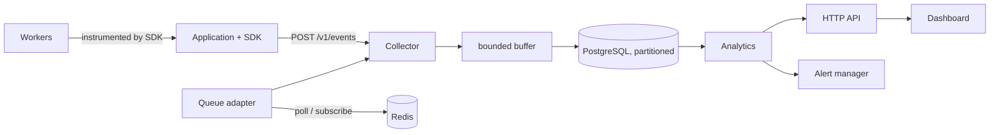

# QueueLens — Implementation Plan

> **This file is the specification.** The overhead budget in section 9 is a release gate, not an aspiration.

---

## 0. Machine context

```yaml
project: QueueLens
status: skeleton
version: 0.0.0
builds: true
functional: false

implemented:
  - repository skeleton
  - server binary that prints its version
  - protocol documentation placeholder

not_implemented:
  - adapter interface
  - redis / bullmq adapter
  - collector ingest api
  - postgres storage
  - worker instrumentation sdk
  - job lifecycle tracking
  - dashboard
  - analytics
  - alerting
  - additional adapters

source_of_truth:
  scope_and_schema: docs/PLAN.md        # this file, section 9 for the event schema
  architecture: docs/ARCHITECTURE.md
  decisions: docs/adr/
  protocol: pkg/protocol/
  status: README.md#roadmap

forbidden_claims:
  - "supports <queue system>" that is not in the adapter table
  - any overhead percentage not produced by tests/bench
  - "real-time" (state the actual p99 ingest latency instead)
  - "no performance impact"

if_uncertain:
  - an adapter is only supported when it has an integration test against a real broker
  - if a number was not measured in this repository, it does not go in the README
```

---

## 1. What this is

A self-hosted observability platform for background job systems. It models the job lifecycle — enqueued,
started, retried, failed, stalled, completed — instead of treating a job as a trace span.

One-line description: *A self-hosted observability platform for distributed background job systems.*

---

## 2. Problem and users

**Problem.** Background jobs fail quietly. A queue grows, retries pile up, a worker stops heartbeating, and
the first signal is a customer complaint. Generic APM shows you a slow span, not "this queue has 40,000
waiting jobs and 12% of them failed in the last hour".

**Users.**

| User | Need |
|---|---|
| Backend engineer | See why one job failed and how many times it retried |
| On-call engineer | Know before the customer does: queue depth, stalls, worker death |
| Platform team | Throughput and latency history per queue, without a vendor |

**Success looks like.** A stalled worker is visible on the dashboard within 60 s, and the on-call engineer
can open the affected job and see its full attempt timeline.

---

## 3. Non-goals

- **Not a queue.** It observes; it never enqueues or consumes production jobs.
- **Not a job scheduler.** Delayed retries stay the queue's responsibility.
- **Not a general APM.** No HTTP tracing, no database query analysis.
- **Not multi-tenant SaaS.** One deployment, one organisation. Auth is a single admin token in v1.
- **No arbitrary user-defined query language** in v1. Alert rules are a fixed set.
- **No log aggregation.** Errors are captured as job metadata, not as a log store.

---

## 4. Scope contract

### v0.1 — MVP (M1–M4)

BullMQ adapter, collector ingest API, Postgres storage, job lifecycle and stall detection, dashboard with
queue overview and job timeline.

### v1.0 (M5–M6)

Latency analytics, alerting, retention and partitioning, horizontal scaling, Asynq adapter, v1.0.0.

### Post-1.0

Sidekiq, Celery, custom adapter SDK published as a Go module, Prometheus exporter endpoint.

---

## 5. Locked decisions

| # | Decision | Rationale |
|---|---|---|
| 1 | Go backend | Stream ingestion is a throughput problem; predictable memory matters |
| 2 | React + TypeScript dashboard | Best ecosystem for data-dense UI |
| 3 | Adapter interface first, one adapter properly | An abstraction invented before two implementations is always wrong |
| 4 | BullMQ is the first adapter | Largest install base among Redis-backed Node queues |
| 5 | Instrumentation never blocks a job | Bounded buffer, drop with a counter, never backpressure the worker |
| 6 | Versioned wire protocol `v1` | Non-Go adapters implement it without importing Go packages |
| 7 | PostgreSQL before ClickHouse | At realistic volumes, partitioned Postgres is sufficient |
| 8 | Overhead < 2% p50 is a release gate | Measured in `tests/bench`, not asserted in prose |

**Rejected alternatives:** polling Redis `KEYS` (does not scale, no history), an agent inside the application
that owns its own storage (operationally heavy), Kafka ingestion (adds a dependency before the product has
users), stored procedures for analytics (hard to test, hard to evolve).

---

## 6. Architecture



### Components

| Component | Responsibility | Must never |
|---|---|---|
| Adapter | Translate broker state into protocol events | Block on the collector |
| Collector | Validate, buffer, batch-insert events | Apply business logic |
| Storage | Partitioned event table, rollups | Store unbounded raw events |
| Analytics | Lifecycle reconstruction, percentiles, stall detection | Query raw events for every dashboard request |
| API | Serve dashboard queries | Expose unbounded result sets |
| Alert manager | Evaluate rules, deduplicate, notify | Fire on a single sample |
| SDK | Emit events with negligible overhead | Require network calls from the job path |

### Data path

Two ingestion paths exist and they are not equivalent:

1. **Push (SDK)** — the application emits lifecycle events. Precise, requires an integration.
2. **Pull (adapter)** — QueueLens polls the broker. Works with no code change, cannot see in-job timing.

v0.1 ships **pull** only. The SDK arrives at M2 and is what makes latency accurate.

---

## 7. Data model

```sql
CREATE TABLE queue_events (
    id           bigserial,
    ts           timestamptz NOT NULL,
    queue        text NOT NULL,
    job_id       text NOT NULL,
    job_name     text NOT NULL DEFAULT '',
    attempt      smallint NOT NULL DEFAULT 1,
    state        text NOT NULL CHECK (state IN
                 ('enqueued','started','completed','failed','retried','stalled','drained')),
    worker_id    text,
    duration_ms  integer,
    error        text,
    received_at  timestamptz NOT NULL DEFAULT now(),
    PRIMARY KEY (ts, id)
) PARTITION BY RANGE (ts);

CREATE TABLE job_runs (
    queue        text NOT NULL,
    job_id       text NOT NULL,
    job_name     text NOT NULL DEFAULT '',
    enqueued_at  timestamptz,
    started_at   timestamptz,
    finished_at  timestamptz,
    attempts     smallint NOT NULL DEFAULT 0,
    final_state  text,
    last_error   text,
    updated_at   timestamptz NOT NULL DEFAULT now(),
    PRIMARY KEY (queue, job_id)
);

CREATE TABLE workers (
    worker_id   text PRIMARY KEY,
    pool        text NOT NULL DEFAULT '',
    first_seen  timestamptz NOT NULL DEFAULT now(),
    last_seen   timestamptz NOT NULL DEFAULT now()
);

CREATE TABLE metrics_hourly (
    queue        text NOT NULL,
    bucket       timestamptz NOT NULL,
    enqueued     integer NOT NULL DEFAULT 0,
    completed    integer NOT NULL DEFAULT 0,
    failed       integer NOT NULL DEFAULT 0,
    p50_ms       integer,
    p95_ms       integer,
    p99_ms       integer,
    PRIMARY KEY (queue, bucket)
);

CREATE TABLE alert_rules (
    id          uuid PRIMARY KEY DEFAULT gen_random_uuid(),
    name        text NOT NULL,
    kind        text NOT NULL CHECK (kind IN
                ('queue_depth','failure_rate','p99_latency','stalled_jobs','worker_down')),
    threshold   numeric NOT NULL,
    window_s    integer NOT NULL DEFAULT 300,
    enabled     boolean NOT NULL DEFAULT true
);

CREATE TABLE alerts_fired (
    id          bigserial PRIMARY KEY,
    rule_id     uuid NOT NULL REFERENCES alert_rules(id) ON DELETE CASCADE,
    fired_at    timestamptz NOT NULL DEFAULT now(),
    resolved_at timestamptz,
    value       numeric NOT NULL,
    payload     jsonb NOT NULL DEFAULT '{}'
);
```

Rules: monthly partitions created two months ahead; raw events retained 30 days by default; rollups retained
400 days; `job_runs` pruned when finished and older than 30 days.

---

## 8. API surface

Collector:

| Method | Path | Purpose |
|---|---|---|
| POST | `/v1/events` | Batch ingest, max 1,000 events or 1 MiB |
| POST | `/v1/workers/heartbeat` | Worker liveness |

Query API:

| Method | Path | Purpose |
|---|---|---|
| GET | `/v1/queues` | Queue list with depth, throughput, failure rate |
| GET | `/v1/queues/{queue}` | Detail, last 24 h series |
| GET | `/v1/queues/{queue}/jobs` | Cursor-paginated jobs by state |
| GET | `/v1/jobs/{queue}/{job_id}` | Job plus attempt timeline |
| GET | `/v1/workers` | Worker list with last heartbeat |
| GET | `/v1/metrics/timeseries` | `?queue=&metric=&from=&to=&step=` |
| GET/POST/PATCH | `/v1/alert-rules` | Alert rule CRUD |
| GET | `/v1/alerts` | Fired alerts |
| GET | `/healthz`, `/readyz`, `/metrics` | Operational |

Auth: `Authorization: Bearer <token>` from `QUELENS_ADMIN_TOKEN`. The collector accepts the same token; v1 has
no separate ingest key.

Ingest response: `202 {"accepted": 1000, "dropped": 0}`. On saturation: `429` with `Retry-After: 1`.
The SDK treats both as non-fatal and never retries synchronously.

---

## 9. Core contract: protocol and overhead

### Event schema v1

```json
{
  "v": 1,
  "id": "01J8Z8Q9K3",
  "ts": "2026-11-13T10:00:00.123Z",
  "queue": "email",
  "job_id": "8891",
  "job_name": "send-welcome",
  "attempt": 2,
  "state": "failed",
  "worker_id": "w-7",
  "duration_ms": 340,
  "error": "SMTP timeout"
}
```

Unknown fields are ignored; `v` must be `1`. Missing `queue` or `job_id` rejects the event. `ts` older than
7 days is rejected (clock skew guard) but counted, not silently dropped.

### Overhead budget (release gate)

| Metric | Budget |
|---|---|
| Added p50 latency per instrumented job | < 2% |
| Added p99 latency | < 5% |
| Allocation per emitted event | < 512 B |
| Collector ingest | < 50 ms per 1,000-event batch |
| Drop rate under load test with a dead collector | 100% of events, 0% of jobs blocked |

The SDK's `Emit` is a non-blocking send to a buffered channel (capacity 10,000). On a full buffer it increments
`queuelens_dropped_total` and returns. **It never blocks and never allocates on the hot path beyond the event
struct.**

### Lifecycle reconstruction

For each job, events are folded in `ts` order:

- `enqueued` sets `enqueued_at`
- `started` sets `started_at`, increments `attempts`
- `completed` sets `finished_at`, `final_state = completed`
- `failed` sets `last_error`; `final_state` becomes `failed` unless a later `retried` arrives
- out-of-order events are tolerated: state transitions are idempotent and monotonic

### Stall detection

| Condition | Verdict |
|---|---|
| `waiting` job with no `started` event for > 10 min | stalled queue |
| `active` job with no heartbeat for > 2 × expected duration | stalled job |
| Worker with `last_seen` > 60 s | worker down |
| `job_runs` row with `attempts = max_attempts` and `final_state = failed` | dead job |

Thresholds are configurable but the defaults are documented and tested.

---

## 10. Configuration

| Variable | Default | Notes |
|---|---|---|
| `QUELENS_HTTP_ADDR` | `:8080` | API and collector |
| `QUELENS_POSTGRES_DSN` | required | |
| `QUELENS_REDIS_URL` | required for BullMQ adapter | |
| `QUELENS_ADMIN_TOKEN` | required | bearer token |
| `QUELENS_ADAPTERS` | `bullmq` | comma-separated |
| `QUELENS_POLL_INTERVAL` | `5s` | adapter poll cadence |
| `QUELENS_BUFFER_SIZE` | `10000` | collector buffer |
| `QUELENS_BATCH_SIZE` | `500` | insert batch |
| `QUELENS_RETENTION_RAW_DAYS` | `30` | raw events |
| `QUELENS_RETENTION_ROLLUP_DAYS` | `400` | hourly rollups |
| `QUELENS_LOG_LEVEL` | `info` | |

---

## 11. Milestones

### M1 — Adapter interface and collection

**Deliverable:** adapter interface, BullMQ adapter (poll mode), collector ingest API, raw storage, load
generator.

**Acceptance criteria**

- [ ] BullMQ queues, waiting/active/completed/failed counts visible via `GET /v1/queues`
- [ ] Collector accepts 1,000-event batches and rejects malformed events with a per-event reason
- [ ] Buffer saturation returns `429` and increments a counter; no event is silently lost without a counter
- [ ] Load generator sustains 5,000 events/s ingest for 5 minutes on 4 vCPU
- [ ] Adapter failure is isolated: a broken Redis connection does not crash the collector

### M2 — Instrumentation SDK

**Deliverable:** Go and TypeScript SDKs emitting lifecycle events, worker heartbeat, overhead benchmark.

**Acceptance criteria**

- [ ] `Emit` never blocks under a dead collector (test: kill collector, run 1M jobs, assert job latency
      unchanged within noise)
- [ ] Added p50 latency < 2% in `tests/bench`, report committed
- [ ] Buffer overflow increments `queuelens_dropped_total`
- [ ] SDK works with no configuration beyond the collector URL and token
- [ ] Both SDKs implement protocol v1 and pass the shared conformance test

### M3 — Lifecycle and failure analysis

**Deliverable:** `job_runs` folding, stall detection, failed/stalled views, retention job.

**Acceptance criteria**

- [ ] Out-of-order events fold into the correct final state (property test with shuffled input)
- [ ] Stalled job detected within 2 poll intervals
- [ ] Dead worker flagged within 60 s of last heartbeat
- [ ] Retention job drops partitions older than configured days
- [ ] Partition creation covers the next two months automatically

### M4 — Dashboard

**Deliverable:** React dashboard: overview, queue detail, job timeline, workers.

**Acceptance criteria**

- [ ] Overview shows depth, throughput and failure rate for every queue
- [ ] Job timeline renders every attempt with duration and error
- [ ] Dashboard p95 query < 300 ms for 30 days of hourly rollups
- [ ] No unbounded table: every list is paginated
- [ ] One screenshot in the README from a real local run

### M5 — Metrics, alerts, analytics

**Deliverable:** hourly rollups with percentiles, alert rules, alert history, `/metrics` endpoint.

**Acceptance criteria**

- [ ] Percentiles computed from real durations, not averages of averages
- [ ] Alert fires once per window, not once per evaluation
- [ ] Alert resolves automatically when the condition clears
- [ ] Prometheus endpoint exposes queue depth, failure rate and collector lag
- [ ] Analytics queries use rollups, never scan raw partitions

### M6 — Scale and second adapter

**Deliverable:** horizontal collector scaling, Asynq adapter, v1.0.0, capacity documentation.

**Acceptance criteria**

- [ ] Two collector instances behind a load balancer, no duplicate job state corruption
- [ ] Asynq adapter passes the same conformance suite as BullMQ
- [ ] Sustained 20,000 events/s ingest documented with hardware
- [ ] Overhead gate still passes after all additions
- [ ] `CHANGELOG.md` and README roadmap complete

---

## 12. Backlog

| ID | Task | Depends | Milestone |
|---|---|---|---|
| QL-001 | Server skeleton, config, logging, health | — | M1 |
| QL-002 | Protocol v1 types and validation | — | M1 |
| QL-003 | Adapter interface and registry | QL-002 | M1 |
| QL-004 | BullMQ adapter: queue discovery | QL-003 | M1 |
| QL-005 | BullMQ adapter: counts by state | QL-004 | M1 |
| QL-006 | Collector ingest endpoint with batching | QL-002 | M1 |
| QL-007 | Bounded buffer and drop counter | QL-006 | M1 |
| QL-008 | Batch writer to partitioned table | QL-007 | M1 |
| QL-009 | Load generator | QL-006 | M1 |
| QL-010 | Go SDK emit API | QL-002 | M2 |
| QL-011 | TS SDK emit API | QL-002 | M2 |
| QL-012 | Non-blocking buffer test (dead collector) | QL-010 | M2 |
| QL-013 | Overhead benchmark and report | QL-012 | M2 |
| QL-014 | Worker heartbeat endpoint and table | QL-001 | M2 |
| QL-015 | Lifecycle folder (events → job_runs) | QL-008 | M3 |
| QL-016 | Out-of-order property test | QL-015 | M3 |
| QL-017 | Stall and dead-worker detection | QL-015 | M3 |
| QL-018 | Retention and partition maintenance | QL-008 | M3 |
| QL-019 | Query API: queues and jobs | QL-015 | M4 |
| QL-020 | Dashboard scaffolding | QL-019 | M4 |
| QL-021 | Overview and queue detail views | QL-020 | M4 |
| QL-022 | Job timeline view | QL-021 | M4 |
| QL-023 | Hourly rollups and percentiles | QL-015 | M5 |
| QL-024 | Alert rule evaluation and dedup | QL-023 | M5 |
| QL-025 | Alert notification channel | QL-024 | M5 |
| QL-026 | Prometheus `/metrics` | QL-023 | M5 |
| QL-027 | Multi-instance collector coordination | QL-008 | M6 |
| QL-028 | Asynq adapter + conformance suite | QL-003 | M6 |
| QL-029 | Capacity test and documentation | QL-027 | M6 |
| QL-030 | v1.0.0 release checklist | QL-025 | M6 |

---

## 13. Testing strategy

- **Conformance suite** runs against every adapter. A new adapter is not supported until it passes.
- **Property tests** for lifecycle folding with shuffled, duplicated and late events.
- **Overhead benchmark** is a CI job with a fixed workload; regression beyond budget fails the build.
- **Kill tests:** kill the collector, kill the collector mid-batch, kill Redis. The application must not
  notice beyond a dropped-event counter.
- **Query budget tests** assert dashboard queries never scan raw partitions.

---

## 14. Security and threat model

| Threat | Mitigation |
|---|---|
| Collector used as an injection point | Strict schema validation, bounded batch, `queue`/`job_id` length limits |
| Error strings contain secrets | 1 KiB cap, redaction of common token patterns, documented as best-effort |
| Dashboard exposed publicly | Single admin token, `Secure` cookie optional, docs say "put it behind your SSO" |
| SQL injection via queue names | Parameterised queries only; queue names filtered by regex |
| Storage exhaustion | Retention, partitioning, ingest limit, 429 |
| Adapter credentials | Read from environment, never logged |

---

## 15. Risks and open questions

| Risk | Impact | Mitigation |
|---|---|---|
| Poll-only adapters miss in-job timing | Wrong latency numbers | SDK is the accurate path; UI labels poll-derived data |
| Overhead regression over time | Tool becomes a problem | Benchmark gate in CI |
| Postgres write amplification | Collector lag | Batch inserts, monthly partitions, rollups |
| Adapter abstraction leaks BullMQ concepts | Second adapter is a rewrite | Conformance suite forces protocol-level thinking |

**Open questions:**

1. Is a separate ingest token needed in v1? *Current: no, one admin token.*
2. Should `job_runs` be a materialised view or a table? *Current: table, updated by the folder.*
3. ClickHouse at what threshold? *Current: revisit at 50M events/day, with a measured report.*

---

## 16. Anti-hallucination contract

**Facts:** the server starts, prints its version and exits. There is no adapter, no collector, no database and
no dashboard.

**Rules:**

1. Never claim support for a queue system absent from the adapter table in the README.
2. Never quote an overhead number that is not in `docs/benchmarks/` and produced by `tests/bench`.
3. Do not call the product "real-time". State the measured p99.
4. Drop counters are mandatory: losing events silently is a bug, losing them with a counter is a documented
   trade-off.
5. Update the adapter table, README roadmap and CHANGELOG in the same pull request.

**Glossary:**

| Term | Meaning |
|---|---|
| Adapter | Translates one broker's state into protocol events. |
| Collector | HTTP ingest, buffering and persistence. |
| Protocol event | One lifecycle fact about one job. Versioned, immutable. |
| Job run | Folded view of all events for one job. |
| Stall | A job or queue that has stopped making progress. |
| SDK | In-process emitter; the only source of accurate duration. |

---

## 17. Handoff protocol

1. Read sections 0, 3 and 9.
2. `make build && ./bin/queuelens version`.
3. Start at QL-002: the protocol is the contract everything else depends on.
4. Run the overhead benchmark before and after any change to the emit path.
5. Never add an adapter without the conformance suite.
